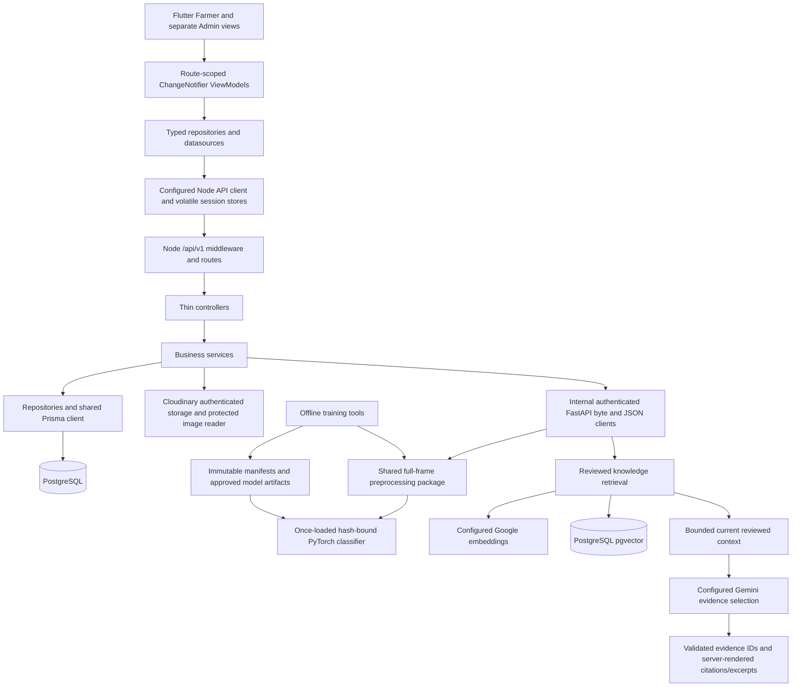

# Phase 24.5 — as-built architecture and component connections

Read alongside the [API contracts](phase-24-5-api-contracts.md) and
[vertical slices](phase-24-5-vertical-slices.md). This diagram follows actual
`mobile/lib/app.dart`, `backend/src/app.ts` and `ai-service/app/main.py` composition.
It is not the historical target diagram.

No Flutter → FastAPI/Google/Cloudinary-secret route was found. Python directly owns
knowledge/vector SQL by design; Node owns business authorization and scan/account
SQL. Shared preprocessing is the only serving transform. Cloudinary receives a
separate sanitized display copy; inference receives the original admitted bytes.

| Component / producer → consumer | Actual connection and input → output | Failure, configuration and verification |
|---|---|---|
| MainApp → feature routes | `app.dart` provides repositories; `app_router.dart` creates scoped ViewModels | Repository injection; providers disposed; navigation and identity-switch tests |
| Registration/sign-in → auth repository | Email/password JSON → safe account/access JWT + refresh cookie | Zod, duplicate/role/password errors; JWT env; auth tests and real registration gate |
| MemorySessionTokens → ApiClient | Session revision and rotating credentials → authenticated requests | One refresh flight, failed refresh clears session; no durable tokens; session/repository tests |
| Profile editor → ApiProfileRepository | Revision-pinned private fields/photo → safe profile projection | Own account only; conflict/reload; real persistence/photo/reconstruction gate |
| Picker → scan repository | Gallery/system camera bytes → preview/validated multipart | Cancellation/lost-data recovery; camera platform support; native permission acceptance not verified |
| Scan ViewModel → datasource → scan routes | Original image + idempotency key → durable scan/status/prediction | Bounded upload, HTTP progress and retry, no fake ML progress; live guest/farmer gates |
| Node scan service → Cloudinary | Admitted image → metadata-free authenticated display asset | Server credentials, controlled namespace, upload journal/compensation; actual upload/delete fixture proofs |
| Node scan service → AI inference client | Original bytes, configured origin/token/version → strict prediction DTO | Whole-call deadline/size/redirect/schema checks; unavailable/timeouts mocked safely; real pinned model exercised |
| AI lifespan → artifact loader | Pinned metadata/checkpoint/calibration → once-loaded CPU model | Fail closed for missing/hash/config/mapping/state mismatches; env artifact locations, no downloads |
| Shared preprocessing → training/AI | Validated oriented RGB frame → 224×224 normalized CHW float32/tensor | Shared package imports and explicit config; synthetic cross-environment exact parity |
| Scan repository → Prisma/PostgreSQL | Lease-bound prediction and model identity → atomic completed scan | Transaction/row fencing, failure recovery, preserved original scan; actual DB and upload tests |
| History/result → records repository | Owned scan IDs/cursors → list/detail/image path | FARMER principal or original guest capability; wrong owner/Admin denied; pagination/live tests |
| PrivateImage widget → repository → Node | Exact relative DTO path + current auth/capability → bounded image bytes | Two active/32 queued, revision fences, no redirects, no-store, retry/dispose tests and actual image gate |
| Knowledge UI → knowledge repository | Catalogue slug/query/filter → current source-backed sections/matches | PostgreSQL catalogue; Google/pgvector search; wrong class/stale/provider failure tests |
| AI retrieval → Google + pgvector | Configured embedding/model/version and filters → top bounded reviewed chunks | Parameterized SQL, vector metadata identity, current active document/disease; actual embeddings/retrieval/indexing |
| Assistant/scan result → Node generation | Current question or owned persisted classifier scalars → structured sourced response | Bounded context; no photo/identity/capability sent to Gemini; classifier identity preserved |
| Gemini provider → evidence renderer | Reviewed prompt/evidence → validated selected IDs → exact excerpts/citations | Official SDK, one bounded call, explicit abstention/conflict; real provider and mocked failure/injection tests |
| Calculator ViewModels → Node engines | Selected immutable rule/config version and decimal area/unit → exact decimal quantity | Reviewed-only rules; exact rational arithmetic, one HALF_UP round; synthetic live fixtures; real content absent |
| Farmer analytics → SQL aggregates | Own principal, bounded dates/cursor → counters/distribution/activity | Server aggregation and ownership; no claimed accuracy; DB/Flutter/live synthetic checks |
| Admin overview → aggregate repository | ADMIN/date window → account/scan counts and registry configuration | Farmer denial, date validation; AI request data explicitly unavailable; live dashboard gate |
| Admin management → Node → AI indexer | Reviewed draft/version/source → inactive ready chunks → explicit publication | Serialized version changes/audits; provider failures leave inactive draft; archive removes active retrieval |
| Admin farmers/audit → repositories | Confirmed revision-pinned status change → revoked sessions + immutable audit | One transaction, rollback on audit failure, redacted paginated projection; actual gate |
| Admin model health → Node/AI/registry | Registry + authenticated model probe → offline evidence/runtime counters | Incompatible/unavailable distinct; process-only runtime; no ground-truth drift; actual gate |
| Cleanup CLIs → scan/profile journal | Owned pending/stale attempts → bounded idempotent cleanup | Current/committed/pending assets fenced; provider/DB uncertainty retained; deployment scheduling absent |
| Development scripts → child checks | Reviewed OS/SDK allowlist + generated fixture credentials → checks | Server secrets not inherited; actual sentinel tests; not an OS sandbox |

## Disconnected and reserved structures

| Structure | Actual consumer/writer | Classification |
|---|---|---|
| `disease_images` | No application writer, delivery contract, provenance review or Farmer gallery | Incomplete mandatory disease-media feature; licensed assets also absent |
| `ai_queries` / `ai_responses` | No runtime request writer; dashboard deliberately returns NOT_RECORDED | Reserved persistence plus incomplete original AI operational monitoring; not proof of zero AI usage |
| `model_metrics` | Empty; actual dashboard reads hash-bound artifact metrics via AI, registry metadata via Node | Reserved alternative persistence, not a broken dashboard or missing model evaluation |
| `history` | No general history writer; scan history queries owned `scans`/latest predictions | Reserved extension; working scan history does not require duplicate rows |
| `notifications` | No delivery service/UI | Reserved future extension; table creation alone was requested, notification delivery was not made mandatory |
| Disease structured arrays/stages/severity | Main knowledge comes from immutable sourced documents; stage/severity fields have no Admin/API/Farmer workflow | Document canonicalization is intentional; missing original stage/severity management/display remains a product gap |
| Fertilizer product metadata | Frozen reviewed snapshot coupled to versioned rules; no independent editable product catalogue | Safe implemented baseline; broader original standalone fertilizer management remains partial |
| Calculator explanation routes | No dedicated Gemini calculator explanation endpoint | Optional original “may explain” extension; numerical engines remain deterministic |

There are incomplete original capabilities; the unconditional “no disconnected
component” statement would therefore be inappropriate. No broken connection was
identified in the implemented and successfully exercised vertical slices.
