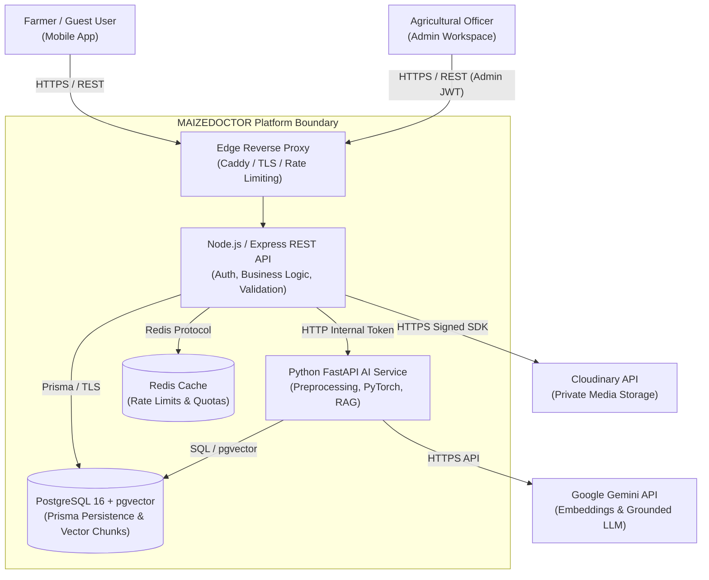
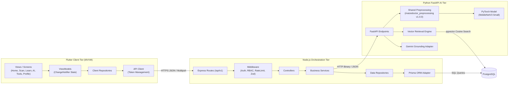
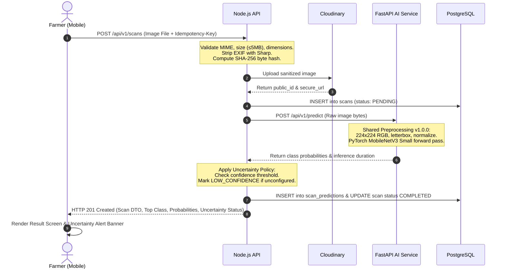
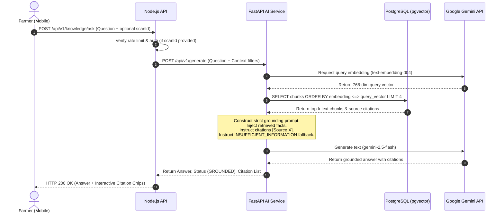
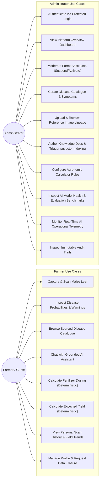
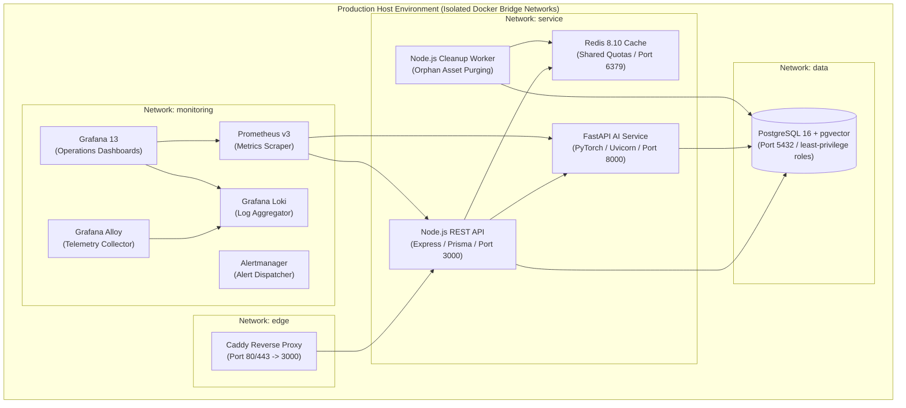

# Software Requirements Specification (SRS)
## MAIZEDOCTOR: AI-Powered Maize Disease Detection and Agricultural Decision-Support Platform

**Document Version:** 1.0.0
**Status:** Canonical Implementation Specification
**Standard Compliance:** ISO/IEC/IEEE 29148:2018 / IEEE Std 830-1998
**Project Root:** `E:\MAIZEDOCTOR`
**Classification:** Academic Engineering & Production Architecture Specification

---

## Table of Contents

1. [Introduction](#1-introduction)
   - 1.1 Purpose
   - 1.2 Scope of the System
   - 1.3 Product Overview
   - 1.4 Intended Audience
   - 1.5 Definitions, Acronyms, and Abbreviations
   - 1.6 Document References
2. [Overall Description](#2-overall-description)
   - 2.1 Product Perspective & System Topology
   - 2.2 System Operational Modes
   - 2.3 User Classes and User Characteristics
   - 2.4 Operating Environment
   - 2.5 Design and Implementation Constraints
   - 2.6 Core Engineering Invariants
   - 2.7 Assumptions and Dependencies
3. [Specific Functional Requirements](#3-specific-functional-requirements)
   - 3.1 Module 1: Authentication, Authorization, and Session Management
   - 3.2 Module 2: Image Acquisition, Validation, and Scan Ingestion
   - 3.3 Module 3: Computer Vision Preprocessing and Deep Learning Inference
   - 3.4 Module 4: Uncertainty Policy and Prediction Presentation
   - 3.5 Module 5: Agricultural Knowledge Base and Vector Retrieval (RAG)
   - 3.6 Module 6: Grounded Conversational AI Assistant
   - 3.7 Module 7: Deterministic Agricultural Calculators (Fertilizer & Yield)
   - 3.8 Module 8: Farmer Profile, Private Scan History, and Personal Analytics
   - 3.9 Module 9: Administrator Shell, System Dashboard, and Farmer Operations
   - 3.10 Module 10: Admin Content Management (Diseases, Media, Knowledge Ingestion)
   - 3.11 Module 11: Admin Agronomic Rule Authoring and Calculator Configurations
   - 3.12 Module 12: Model Health Monitoring, Telemetry, and Operational Auditing
   - 3.13 Module 13: Data Privacy, Asset Purging, and Deletion Lifecycle
4. [Non-Functional Requirements (NFRs)](#4-non-functional-requirements-nfrs)
   - 4.1 Performance and Concurrency
   - 4.2 Information Security, Access Control, and Data Sanitization
   - 4.3 Reliability, Fault Tolerance, and Graceful Degradation
   - 4.4 Usability, Design System, and Accessibility (a11y)
   - 4.5 Maintainability, Code Quality, and Modularity
   - 4.6 Scalability and Resource Boundaries
   - 4.7 Compatibility and Portability
   - 4.8 Data Protection and Privacy Regulations
5. [External Interface Requirements](#5-external-interface-requirements)
   - 5.1 User Interfaces (Flutter Client)
   - 5.2 Software Interfaces (Node.js REST API & Internal FastAPI AI Endpoints)
   - 5.3 Database Management System Interfaces
   - 5.4 Third-Party Cloud and AI Services (Cloudinary & Google Gemini)
6. [Data Requirements and Schema Specifications](#6-data-requirements-and-schema-specifications)
   - 6.1 Logical Data Model & Entity Dictionary
   - 6.2 Data Integrity, Ownership, and Cascading Constraints
   - 6.3 Media Asset Management and File Lifecycles
7. [System Architecture and Visual Diagrams](#7-system-architecture-and-visual-diagrams)
   - 7.1 System Context Diagram
   - 7.2 High-Level Component Architecture
   - 7.3 End-to-End Disease Detection Workflow
   - 7.4 Grounded Retrieval-Augmented Generation (RAG) Flow
   - 7.5 Farmer and Administrator Use Case Diagram
   - 7.6 Complete Database Entity-Relationship (ER) Diagram
   - 7.7 Container and Deployment Topology
8. [Constraints, Scientific Limitations, and Implementation Status](#8-constraints-scientific-limitations-and-implementation-status)
   - 8.1 Machine Learning and Dataset Scientific Limitations
   - 8.2 Agronomic Calculation Input Boundaries
   - 8.3 Implementation Status Summary
9. [Requirements Traceability Matrix (RTM)](#9-requirements-traceability-matrix-rtm)

---

## 1. Introduction

### 1.1 Purpose
This Software Requirements Specification (SRS) defines the complete, authoritative technical and functional requirements for the **MAIZEDOCTOR** platform. This document reflects the **actual verified codebase** as constructed across the Flutter mobile application, Node.js/TypeScript orchestration backend, Python/FastAPI artificial intelligence service, PostgreSQL database with vector extensions, and supporting infrastructure. It serves as the primary technical baseline for software developers, system architects, machine learning engineers, and evaluators.

### 1.2 Scope of the System
MAIZEDOCTOR is an end-to-end agritech platform designed to deliver real-time maize foliar disease identification, transparent uncertainty estimation, peer-reviewed disease information, grounded artificial intelligence question answering, and deterministic crop input planning.

The platform encompasses three tiers:
1. **Client Tier (`mobile/`):** A cross-platform Flutter application implementing Model-View-ViewModel (MVVM) architecture, a five-tab primary navigation shell, accessible components, and offline-resilient UI state machines.
2. **Orchestration Tier (`backend/`):** A secure, modular Node.js/Express/TypeScript REST API enforcing strict schema validation, cryptographic token management, role-based access control, file sanitization, and database persistence via Prisma ORM.
3. **Intelligence Tier (`ai-service/` & `shared/preprocessing/`):** A containerized Python 3.11/FastAPI service hosting a PyTorch `MobileNetV3 Small` classifier, an authoritative shared computer-vision preprocessing pipeline, a pgvector-backed semantic retrieval engine, and Google Gemini integration with strict citation and grounding safeguards.

### 1.3 Product Overview
Maize (*Zea mays*) is a staple cereal crop vital to food security. Foliar diseases—specifically Common Rust (*Puccinia sorghi*), Gray Leaf Spot (*Cercospora zeae-maydis*), and Northern Corn Leaf Blight (*Exserohilum turcicum*)—cause substantial yield reductions if left untreated. MAIZEDOCTOR addresses these threats by providing:
- Rapid leaf image scanning and multi-class classification.
- Calibration-aware confidence reporting and low-confidence uncertainty disclosures.
- Curated disease profiles detailing symptoms, pathogens, favorable conditions, and preventive measures.
- A conversational AI assistant that retrieves cited, reviewed extension literature and answers natural language inquiries without hallucinations.
- Deterministic calculators for fertilizer dosing and expected yield estimation that strictly prohibit generative language models from performing numerical arithmetic.
- An Administrative control plane for agricultural officers to curate knowledge documents, maintain disease catalogues, verify reference imagery, monitor AI operational health, and inspect audit trails.

### 1.4 Intended Audience
- **Core Developers & Maintainers:** Reference for contract compliance, API endpoints, schema relations, and invariants.
- **Machine Learning Engineers:** Guidelines for artifact ingestion, preprocessing parity, inference throughput, and metric tracking.
- **Agronomic Experts & Reviewers:** Specifications of knowledge provenance, calculation formulas, and review workflows.
- **Academic Evaluators:** Formal system verification, traceability, and architectural integrity.

### 1.5 Definitions, Acronyms, and Abbreviations

| Term / Abbreviation | Definition |
|---|---|
| **API** | Application Programming Interface |
| **BPS** | Bytes Per Second / Bandwidth allocation |
| **CORS** | Cross-Origin Resource Sharing |
| **DTO** | Data Transfer Object |
| **ECE** | Expected Calibration Error |
| **ERD** | Entity-Relationship Diagram |
| **EXIF** | Exchangeable Image File Format (metadata stripped for privacy) |
| **F1-Score** | Harmonic mean of precision and recall (macro-averaged across all classes) |
| **GLS** | Gray Leaf Spot (*Cercospora zeae-maydis*) |
| **HWC / CHW** | Height-Width-Channel vs. Channel-Height-Width tensor dimension formats |
| **JWT** | JSON Web Token (RFC 7519) |
| **LLM** | Large Language Model (specifically Google Gemini) |
| **MVVM** | Model-View-ViewModel architectural design pattern |
| **NCLB** | Northern Corn Leaf Blight (*Exserohilum turcicum*) |
| **NLL** | Negative Log-Likelihood |
| **NFR** | Non-Functional Requirement |
| **pgvector** | Open-source vector similarity search extension for PostgreSQL |
| **RAG** | Retrieval-Augmented Generation |
| **RBAC** | Role-Based Access Control |
| **ROI** | Region of Interest |
| **RTM** | Requirements Traceability Matrix |
| **SRS** | Software Requirements Specification |
| **TTL** | Time To Live |
| **UUID** | Universally Unique Identifier (v4 cryptographic generation) |

### 1.6 Document References
1. *ISO/IEC/IEEE 29148:2018 Systems and software engineering — Life cycle processes — Requirements engineering.*
2. *IEEE Std 830-1998 IEEE Recommended Practice for Software Requirements Specifications.*
3. *MAIZEDOCTOR Engineering Instructions (`AGENTS.md`).*
4. *MAIZEDOCTOR Master System Audit and Phase Traceability (`docs/phase-24-6-traceability.md`, `docs/phase-24-7-integration-stability.md`).*
5. *MAIZEDOCTOR Database Operations and Migrations (`docs/16-database-operations.md`).*
6. *MAIZEDOCTOR OpenAPI 3.1 Specification (`backend/openapi.json`).*
7. *MobileNetV3 Small Corrected V2 Fitness Audit (`ml-training/reports/mobilenet-v3-small-20261009-v2-01-fitness/README.md`).*

---

## 2. Overall Description

### 2.1 Product Perspective & System Topology
MAIZEDOCTOR operates as a distributed multi-service architecture comprising decoupled clients, an API boundary, persistence databases, and containerized microservices:

```
[ Flutter Client (Mobile/Web) ]
           │
           │ HTTPS / TLS (Strict Origin)
           ▼
[ Caddy Edge Proxy (Reverse Proxy & Rate Limiting) ]
           │
           ▼
[ Node.js / TypeScript REST API (Port 3000) ]
     ├── Authentication, Session & RBAC
     ├── Multipart Validation & Sharp EXIF Sanitization
     ├── Prisma ORM Adapter
     ├── Redis Cache & Shared Quotas
     │
     ├── Cloudinary (Private Cloud Image Storage)
     ├── PostgreSQL 16 + pgvector (Data & Embeddings)
     │
     └── [ Python FastAPI AI Service (Port 8000) ]
           ├── Shared Preprocessing (maizedoctor_preprocessing v1.0.0)
           ├── PyTorch MobileNetV3 Small Inference
           ├── Semantic Chunk Retrieval Engine
           └── Grounded Gemini Generation & Citation Adapter
```

### 2.2 System Operational Modes
1. **Anonymous / Guest Mode:** Unregistered users can capture leaf photographs, obtain instant disease classification, inspect uncertainty ratings, search published disease catalogues, utilize deterministic calculators, and ask questions to the AI assistant. Guest scans store a nullable `user_id` and are not linked to any personal history.
2. **Authenticated Farmer Mode:** Registered farmers possess secure JWT sessions with refresh cookies, profile persistence (region, field area, contact info), an avatar upload journal, personal paginated scan history, and aggregated field disease analytics.
3. **Administrator Mode:** Authorized agronomic officers access a dedicated workspace to manage disease catalogue items, verify and publish reference leaf photography, review and index knowledge literature into pgvector, publish calculator rules, monitor real-time AI latency/error metrics, inspect model health dashboards, and audit system events.

### 2.3 User Classes and User Characteristics
- **Guest / Unregistered Farmer:** Possesses basic mobile literacy. Requires clear visual feedback, minimal cognitive load, zero-configuration scanning, and explicit offline/network failure guidance.
- **Authenticated Farmer:** Regularly manages maize acreage. Requires historical comparison of crop health across seasons, field acreage conversions, and personalized scan explanations.
- **System Administrator / Agronomist:** Highly technically and agronomically literate. Requires fine-grained control over document versions, vector embeddings, image copyrights/provenance, calculator constants, and model inference statistics.

### 2.4 Operating Environment
- **Client Mobile Environment:** Android 10.0+ (API level 29 minimum; tested on Android 13 API 33, ARM64 architecture). Flutter SDK 3.11.5+, Dart 3.11.5+.
- **Backend Server Environment:** Node.js runtime `>=24.22.0 <25`, npm package manager, Linux/Windows host.
- **AI Service Environment:** Python `3.11.x`, PyTorch 2.10.0 (CPU wheel for inference efficiency), OpenCV 4.13.0, FastAPI 0.128.5+, Uvicorn.
- **Database Engine:** PostgreSQL 16 with `pgvector` extension, Prisma ORM 7.10.0 with native `@prisma/adapter-pg`.
- **In-Memory Cache & Quotas:** Redis 8.10.2 (Alpine).
- **Edge Reverse Proxy:** Caddy 2.11.7 (Alpine) with automated TLS termination and strict CORS headers.

### 2.5 Design and Implementation Constraints
- **CON-01 (Stateless Auth):** Flutter clients shall never store long-lived credentials in insecure local storage; short-lived access tokens reside in volatile memory and refresh tokens are conveyed via HttpOnly, SameSite cookies.
- **CON-02 (Zero Client Secrets):** Flutter clients shall never receive or store third-party API keys (Cloudinary, Gemini, or database credentials). All third-party interactions must be brokered by the Node API or AI service.
- **CON-03 (No Direct Model Access):** Mobile clients shall never communicate directly with the Python AI service. All requests are routed through Node.js controllers for authentication, rate-limiting, and validation.
- **CON-04 (Container Boundaries):** All production microservices run as non-root users (`read_only: true`, `cap_drop: [ALL]`, `no-new-privileges: true`, isolated tmpfs).

### 2.6 Core Engineering Invariants
1. **CRITICAL ML RULE:** Training and production inference **must use the exact same preprocessing codebase**. The `maizedoctor_preprocessing` package (v1.0.0) is installed as an immutable local dependency in both `ml-training` and `ai-service`.
2. **CALCULATOR RULE:** Agronomic arithmetic (fertilizer rates, nutrient conversions, yield forecasts) **must be purely deterministic**. Large Language Models (Gemini) are strictly prohibited from calculating numbers; Gemini is restricted to explaining deterministic calculations using retrieved context.
3. **GROUNDING INVARIANT:** The AI Assistant **must not act as an ungrounded oracle**. If retrieved semantic context from the agricultural knowledge base is insufficient to answer a farmer's prompt, the system must explicitly emit `INSUFFICIENT_INFORMATION` and refuse speculative advice.
4. **IMAGE METADATA SANITIZATION:** All uploaded photographs must be decoded, validated, and stripped of EXIF/IPTC metadata using `sharp` before persistent storage or inference transmission.

### 2.7 Assumptions and Dependencies
- **AS-01:** Farmers possess mobile devices equipped with autofocus-capable cameras capable of capturing minimum 224×224 resolution images in natural daylight.
- **AS-02:** Cloudinary provides high-availability media storage; in the event of Cloudinary outage, the backend returns graceful degradation errors (`IMAGE_UPLOAD_FAILED`).
- **AS-03:** Google Gemini API provides embedding generation (`text-embedding-004` / 768 dimensions) and text generation (`gemini-2.5-flash`); transient network failures trigger fail-closed error contracts.

---

## 3. Specific Functional Requirements

### 3.1 Module 1: Authentication, Authorization, and Session Management

#### REQ-AUTH-001: Farmer Registration
- **Description:** The system shall allow new farmers to create an account by providing an email address and password.
- **Actor:** Guest.
- **Preconditions:** Valid email format; password meeting complexity requirements (minimum 8 characters, containing uppercase, lowercase, number, and special character).
- **Expected Behavior:** Node backend validates payload using Zod, hashes password using Argon2id, generates a UUIDv4 user record with role `FARMER`, provisions an associated `FarmerProfile`, and issues short-lived JWT access token and HttpOnly refresh cookie.
- **Postconditions:** User record created in database with `status = ACTIVE`.
- **Acceptance Criteria:** Duplicate email addresses rejected with HTTP 409 Conflict. Password hash never exposed in API responses.
- **Status:** Implemented (`POST /api/v1/auth/register`).

#### REQ-AUTH-002: User Authentication & Token Issuance
- **Description:** The system shall authenticate existing farmers and administrators via credentials.
- **Actor:** Farmer, Administrator.
- **Preconditions:** User exists and has `status = ACTIVE`.
- **Expected Behavior:** Argon2id verification of password hash. On success, an `AuthSession` record is created storing the SHA-256 hash of a cryptographically random refresh token. Returns a signed JWT access token (15-minute TTL) and sets an HttpOnly, SameSite, Secure refresh token cookie (7-day TTL).
- **Postconditions:** Active session persisted in `auth_sessions`.
- **Acceptance Criteria:** Invalid credentials return HTTP 401 with generic error message (`INVALID_CREDENTIALS`). Rate limited to 10 attempts per 15-minute window per IP.
- **Status:** Implemented (`POST /api/v1/auth/login`).

#### REQ-AUTH-003: Token Refresh Lifecycle
- **Description:** The system shall seamlessly rotate session tokens without requiring user re-entry of passwords.
- **Actor:** Authenticated Farmer, Administrator.
- **Preconditions:** Valid, non-expired, non-revoked refresh token cookie present in request.
- **Expected Behavior:** Hashes incoming cookie token with SHA-256, validates matching `auth_sessions` record, revokes old session, generates fresh access token and replacement refresh token cookie.
- **Postconditions:** Previous refresh token revoked (`revoked_at` timestamp set).
- **Acceptance Criteria:** Replayed or revoked refresh tokens immediately invalidate all sessions for that user identity (token reuse detection).
- **Status:** Implemented (`POST /api/v1/auth/refresh`).

#### REQ-AUTH-004: Role-Based Access Control (RBAC)
- **Description:** The system shall enforce role segregation between `FARMER` and `ADMIN` identities.
- **Actor:** System Gateway / Middleware.
- **Expected Behavior:** Endpoints prefixed with `/api/v1/admin/*` require a valid JWT with claim `role == 'ADMIN'`. Requests with `role == 'FARMER'` or anonymous requests receive HTTP 403 Forbidden.
- **Acceptance Criteria:** Automated integration tests confirm farmers cannot access admin routes or trigger administrative mutations.
- **Status:** Implemented (`requireAdmin` middleware).

#### REQ-AUTH-005: Headless Admin Provisioning
- **Description:** The system shall provide an interactive CLI tool for secure administrator account creation without exposing credentials in web endpoints or seed files.
- **Actor:** DevOps Engineer / System Administrator.
- **Expected Behavior:** Terminal script prompts for email and hidden, confirmed password; creates `ADMIN` user record directly via Prisma.
- **Acceptance Criteria:** Script refuses to overwrite existing accounts or grant admin privileges to existing farmers.
- **Status:** Implemented (`npm run admin:seed`).

---

### 3.2 Module 2: Image Acquisition, Validation, and Scan Ingestion

#### REQ-SCAN-001: Mobile Image Capture and Selection
- **Description:** The mobile application shall allow the user to acquire maize leaf photographs via on-device camera or photo library.
- **Actor:** Farmer, Guest.
- **Preconditions:** Camera or photo library permission granted by device OS.
- **Expected Behavior:** Client presents options for camera capture or gallery selection; captures image and displays immediate preview with retake and submit actions.
- **Acceptance Criteria:** Handles permission denials gracefully with informative UI alerts. Prevents non-image file selection.
- **Status:** Implemented (`mobile/lib/features/disease_detection/`).

#### REQ-SCAN-002: Client-Side Pre-Upload Validation
- **Description:** The mobile client shall validate image properties before transmitting bytes across the network.
- **Actor:** Client Application.
- **Expected Behavior:** Checks file size (maximum 5 MiB) and supported MIME types (`image/jpeg`, `image/png`, `image/webp`). Rejects files exceeding constraints with localized error messages before initiating HTTP request.
- **Status:** Implemented.

#### REQ-SCAN-003: Server-Side Sanitization and Idempotency
- **Description:** The backend API shall enforce byte-level validation, cryptographic deduplication, and EXIF sanitization.
- **Actor:** Backend API (`POST /api/v1/scans`).
- **Preconditions:** Multipart/form-data payload with file field `image` and client-supplied `Idempotency-Key`.
- **Expected Behavior:**
  1. Computes SHA-256 hash of raw incoming bytes.
  2. Checks `scan_uploads` for existing request key hash or byte hash to prevent duplicate charges or processing.
  3. Uses `sharp` to strip all EXIF, GPS, camera serials, and thumbnail metadata.
  4. Enforces dimensional limits: minimum 16×16 pixels, maximum 16,000,000 pixels.
- **Postconditions:** Sanitized image stored in Cloudinary private folder; metadata recorded in `scans` table.
- **Status:** Implemented.

#### REQ-SCAN-004: Protected Image Proxy Delivery
- **Description:** The system shall restrict image access such that raw Cloudinary storage URLs, credentials, or upload presets are never exposed to clients.
- **Actor:** Farmer, Guest, Admin.
- **Expected Behavior:** Images are served through `GET /api/v1/scans/{scanId}/image`. Backend authenticates ownership (for private farmer scans) or allows public access (for reference library), streams byte stream with `Cache-Control: private, no-transform`, and prevents direct hotlinking.
- **Status:** Implemented (`createPrivateImageReader`).

---

### 3.3 Module 3: Computer Vision Preprocessing and Deep Learning Inference

#### REQ-ML-001: Shared Computer Vision Preprocessing
- **Description:** The system shall execute a single, immutable preprocessing algorithm across both training pipeline and real-time production inference.
- **Actor:** AI Service (`maizedoctor_preprocessing v1.0.0`).
- **Expected Behavior:**
  1. Image Decoding: Strict decoding to 8-bit unsigned RGB.
  2. Bounded Input Validation: Max 5 MiB, max 16 MP, min 16 px dimension.
  3. Background Segmentation: Conservative removal of uniform background connected to perimeter; non-green lesion tissue enclosed within the leaf perimeter is strictly preserved.
  4. Aspect-Preserving Letterboxing: Resizes image to fit 224×224 bounding box with reflection or constant padding to prevent spatial distortion.
  5. Tensor Normalization: Scales pixel values to `[0.0, 1.0]` and applies ImageNet standard normalization (mean = `[0.485, 0.456, 0.406]`, std = `[0.229, 0.224, 0.225]`).
  6. Output Tensor: Shape `(3, 224, 224)` in contiguous CHW `float32` representation.
- **Acceptance Criteria:** Parity check script confirms 100% bitwise parity across 8 synthetic and 160 real leaf test cases between training and inference environments.
- **Status:** Implemented (`shared/preprocessing/`).

#### REQ-ML-002: Deep Learning Disease Classification
- **Description:** The AI service shall execute PyTorch inference on the preprocessed tensor to output probability distributions over four mutually exclusive classes.
- **Actor:** AI Service (`POST /api/v1/predict`).
- **Classes:**
  1. `Common_Rust` (Puccinia sorghi) — Index 0
  2. `Gray_Leaf_Spot` (Cercospora zeae-maydis) — Index 1
  3. `Healthy` — Index 2
  4. `Northern_Corn_Leaf_Blight` (Exserohilum turcicum) — Index 3
- **Model Architecture:** `MobileNetV3 Small`, checkpoint `epoch-008.pt` (SHA-256: `e95a2e83262637fc1a08b919e6003bddb2fe70664b9c51418f059b7c8287dc66`).
- **Conformity:** CPU execution with bounded concurrency (`BoundedSemaphore(1)`) to ensure predictable memory usage.
- **Status:** Implemented.

---

### 3.4 Module 4: Uncertainty Policy and Prediction Presentation

#### REQ-UNC-001: Calibration-Aware Confidence Policy
- **Description:** The AI service shall evaluate predicted probabilities against a formal confidence threshold policy.
- **Actor:** AI Service.
- **Expected Behavior:** Where no field-validated operational cutoff has been approved by domain authorities, the system shall default to `confidence_threshold = null` and emit `prediction_status = 'LOW_CONFIDENCE'` with `uncertainty_reason = 'THRESHOLD_UNCONFIGURED'`.
- **Acceptance Criteria:** The system never fabricates high confidence or locks an unverified numerical threshold.
- **Status:** Implemented.

#### REQ-UNC-002: Transparent Prediction Breakdown
- **Description:** The mobile interface shall present complete probability distributions and uncertainty warnings to the farmer.
- **Actor:** Client UI (`mobile/lib/features/disease_detection/`).
- **Expected Behavior:**
  - Displays top predicted disease class with formatted visual badge.
  - Renders horizontal probability distribution bars for all 4 classes.
  - Displays prominent amber alert banner when prediction is marked `LOW_CONFIDENCE`, advising visual cross-verification against reference symptoms.
  - Provides direct one-tap navigation to "View Sourced Disease Details" and "Ask AI Assistant about this Scan".
- **Status:** Implemented.

---

### 3.5 Module 5: Agricultural Knowledge Base and Vector Retrieval (RAG)

#### REQ-RAG-001: Curated Agricultural Knowledge Corpus
- **Description:** The system shall maintain an immutable, peer-reviewed repository of maize disease, fertilizer, and agronomic management literature.
- **Actor:** System / Agronomist.
- **Content Structure:** Sourced JSON files (`maize-extension-20261012-v1.json`) containing overview, symptoms, causes, favorable environmental conditions, organic treatments, chemical controls, and academic citations.
- **Status:** Implemented (`backend/knowledge/`).

#### REQ-RAG-002: Document Chunking and pgvector Storage
- **Description:** The knowledge curation subsystem shall decompose documents into semantic chunks and generate vector embeddings.
- **Actor:** Knowledge Curator (`python -m app.rag.cli ingest`).
- **Expected Behavior:**
  - Decomposes text into chunks of maximum 1,000 characters with 120-character sliding overlap.
  - Generates 768-dimensional dense vector embeddings using Google Gemini Embedding API.
  - Stores chunks in `knowledge_chunks` table with native PostgreSQL `vector(768)` type.
  - Creates IVFFlat or HNSW cosine similarity index for sub-second retrieval.
- **Status:** Implemented.

#### REQ-RAG-003: Semantic Vector Retrieval
- **Description:** Given a farmer query or disease context, the system shall retrieve the top-k most semantically relevant knowledge chunks.
- **Actor:** AI Service (`POST /api/v1/retrieve`).
- **Parameters:** Query string, topic filter (optional), disease filter (optional), top-k (default 4, max 8).
- **Expected Behavior:** Embeds query, executes cosine distance query (`embedding <=> query_vector`), filters chunks by similarity threshold, and returns ordered context chunks with source references.
- **Status:** Implemented.

---

### 3.6 Module 6: Grounded Conversational AI Assistant

#### REQ-AI-001: Grounded Natural Language Question Answering
- **Description:** The system shall answer farmer questions strictly grounded in retrieved agricultural knowledge chunks.
- **Actor:** Farmer, Guest (`POST /api/v1/knowledge/ask`).
- **Expected Behavior:**
  1. User submits question.
  2. System retrieves relevant chunks via vector search.
  3. System constructs a strict grounding prompt injecting retrieved chunks as authoritative context.
  4. Google Gemini (`gemini-2.5-flash`) generates answer citing chunk identifiers (e.g. `[Source 1]`).
  5. If retrieved context contains no relevant facts, Gemini returns `INSUFFICIENT_INFORMATION` status and the assistant politely informs the farmer that verified advice is unavailable.
- **Acceptance Criteria:** Assistant never provides unverified recommendations or speculative chemical dosages.
- **Status:** Implemented.

#### REQ-AI-002: Scan-Referenced Contextual Explanation
- **Description:** An authenticated farmer shall be able to request an AI explanation of a specific past disease scan.
- **Actor:** Authenticated Farmer (`POST /api/v1/scans/{scanId}/explanation`).
- **Preconditions:** Scan exists and belongs to the authenticated user (`scan.userId == session.userId`).
- **Expected Behavior:** Combines predicted disease class, probabilities, uncertainty reason, and curated disease knowledge into a contextual explanation prompt; returns structured diagnostic interpretation with management recommendations.
- **Security:** Access denied with HTTP 404/403 if user attempts to explain another farmer's scan.
- **Status:** Implemented.

#### REQ-AI-003: Conversational Session State
- **Description:** The mobile application shall maintain conversational message history locally within the active session.
- **Actor:** Client UI (`mobile/lib/features/ai_assistant/`).
- **Expected Behavior:** Renders chat bubbles, interactive source citation chips (tapping opens modal with full reference text), retry actions on connection failures, and quick prompt suggestions. Chat history is preserved during app execution and cleared on session reset.
- **Status:** Implemented.

---

### 3.7 Module 7: Deterministic Agricultural Calculators (Fertilizer & Yield)

#### REQ-CALC-001: Deterministic Fertilizer Dosing Engine
- **Description:** The system shall calculate exact nutrient and commercial fertilizer quantities using deterministic mathematical formulas.
- **Actor:** Farmer, Guest (`POST /api/v1/calculators/fertilizer/calculate`).
- **Preconditions:** Area value > 0; supported unit (`HECTARE` or `ACRE`); valid published `FertilizerRule` ID.
- **Formulas:**
  $$\text{Area}_{\text{ha}} = \begin{cases} \text{Area}_{\text{input}} & \text{if unit is HECTARE} \\ \text{Area}_{\text{input}} \times 0.40468564224 & \text{if unit is ACRE} \end{cases}$$
  $$\text{Required Quantity (kg)} = \text{Area}_{\text{ha}} \times \text{Rule Rate (kg/ha)}$$
  $$\text{Required Quantity (g)} = \text{Required Quantity (kg)} \times 1000$$
- **Invariants:** Pure deterministic calculation in TypeScript. Zero Gemini/LLM arithmetic.
- **Status:** Implemented.

#### REQ-CALC-002: Deterministic Expected Yield Forecasting
- **Description:** The system shall project maize harvest yield based on field area, regional baseline, and target grain density.
- **Actor:** Farmer, Guest (`POST /api/v1/calculators/yield/calculate`).
- **Formulas:**
  $$\text{Yield (Metric Tonnes)} = \text{Area}_{\text{ha}} \times \text{Baseline Yield (t/ha)}$$
  $$\text{Yield (Kilograms)} = \text{Yield (Metric Tonnes)} \times 1000$$
- **Status:** Implemented framework; pending domain approval of production regional yield tables.

---

### 3.8 Module 8: Farmer Profile, Private Scan History, and Personal Analytics

#### REQ-PROF-001: Profile Management
- **Description:** Authenticated farmers shall view and edit their profile metadata.
- **Actor:** Authenticated Farmer (`GET, PATCH /api/v1/profile`).
- **Fields:** `displayName` (1–120 chars), `phone` (optional), `region` (optional), `countryCode` (ISO-3166 2-char), `fieldAreaHectares` (decimal), `preferredLanguage`.
- **Status:** Implemented.

#### REQ-PROF-002: Avatar Upload and Cleanup Journal
- **Description:** Farmers shall upload profile avatars with automated purging of orphaned cloud assets.
- **Actor:** Authenticated Farmer (`POST, DELETE /api/v1/profile/avatar`).
- **Expected Behavior:** Uploads image to Cloudinary, stores public ID in `farmer_profiles.avatar_public_id`, logs previous avatar in `avatar_cleanup_public_ids` journal. Background cleanup worker periodically deletes unreferenced Cloudinary assets.
- **Status:** Implemented.

#### REQ-HIST-001: Private Paginated Scan History
- **Description:** The system shall provide farmers with a chronological, paginated history of their disease scans.
- **Actor:** Authenticated Farmer (`GET /api/v1/scans?page=1&limit=10`).
- **Expected Behavior:** Returns list of scans with thumbnail proxy URLs, predicted class, confidence, date, and status. Scans belonging to other users are strictly excluded.
- **Status:** Implemented.

#### REQ-STAT-001: Personal Field Health Analytics
- **Description:** The system shall aggregate personal scanning activity into actionable field health insights.
- **Actor:** Authenticated Farmer (`GET /api/v1/analytics/scans`).
- **Metrics Computed:**
  - Total scans performed.
  - Healthy vs. diseased leaf ratio.
  - Disease frequency breakdown (percentage Common Rust, GLS, Blight).
  - Time-filtered distributions (last 7 days, 30 days, all time).
- **Status:** Implemented.

---

### 3.9 Module 9: Administrator Shell, System Dashboard, and Farmer Operations

#### REQ-ADM-001: Dedicated Admin Navigation Workspace
- **Description:** The mobile/web application shall provide a separate, protected workspace for administrators.
- **Actor:** Administrator (`/admin`).
- **Features:** Distinct navigation drawer, administrative metrics, and management tools. Non-admin users attempting to open `/admin` routes are redirected to home with access-denied notifications.
- **Status:** Implemented.

#### REQ-ADM-002: System Overview Dashboard
- **Description:** The admin dashboard shall present platform-wide operational statistics.
- **Actor:** Administrator (`GET /api/v1/admin/dashboard`).
- **Aggregates:**
  - Total registered farmers and account status breakdown (ACTIVE, SUSPENDED, DEACTIVATED).
  - Total lifetime scans and scans within last 24 hours / 7 days.
  - Overall disease detection prevalence across all scans.
  - Active model version and AI service readiness status.
- **Status:** Implemented.

#### REQ-ADM-003: Farmer Account Governance
- **Description:** Administrators shall inspect registered farmer accounts and modify status.
- **Actor:** Administrator (`GET /api/v1/admin/farmers`, `PATCH /api/v1/admin/farmers/{id}/status`).
- **Actions:** Suspend abusive accounts (`SUSPENDED`), reactivate (`ACTIVE`), or deactivate (`DEACTIVATED`). Every status mutation is committed with an immutable `AuditLog` entry.
- **Status:** Implemented.

---

### 3.10 Module 10: Admin Content Management (Diseases, Media, Knowledge Ingestion)

#### REQ-CNT-001: Disease Catalogue Authoring
- **Description:** Administrators shall manage the master catalogue of maize foliar diseases.
- **Actor:** Administrator (`GET, POST /api/v1/admin/knowledge/diseases`, `PATCH /api/v1/admin/knowledge/diseases/{slug}`).
- **Fields:** Slug, common name, scientific name, severity rating (LOW, MODERATE, HIGH), symptoms array, causes array, treatments array, favorable conditions array, affected growth stages.
- **Status:** Implemented.

#### REQ-CNT-002: Reference Image Lifecycle and Lineage
- **Description:** Administrators shall upload, review, publish, and replace verified disease reference images.
- **Actor:** Administrator (`/api/v1/admin/disease-images`).
- **Lifecycle:** `DRAFT` $\to$ `ACTIVE` $\to$ `REPLACED` $\to$ `CLEANUP_PENDING`.
- **Requirements:**
  - Requires explicit alt text, sort order, and provenance JSON (photographer, licensing rights, collection location).
  - Replaced images maintain pointer to predecessor (`replacementFor` foreign key).
  - Public catalogue endpoints only expose `ACTIVE` images.
- **Status:** Implemented.

#### REQ-CNT-003: Knowledge Document Drafting and Vector Indexing
- **Description:** Administrators shall author knowledge documents and trigger vector embedding generation.
- **Actor:** Administrator (`POST /api/v1/admin/knowledge/documents/{id}/index`).
- **Behavior:** Backend dispatches indexing job to Python AI service (`/api/v1/knowledge/index`), which generates 768-dim embeddings for all chunks, updates `embedding_status = 'READY'`, and activates document for semantic search.
- **Status:** Implemented.

---

### 3.11 Module 11: Admin Agronomic Rule Authoring and Calculator Configurations

#### REQ-RUL-001: Fertilizer Rule Management
- **Description:** Administrators shall author and publish versioned fertilizer application rules.
- **Actor:** Administrator (`GET, POST /api/v1/admin/calculators/fertilizer/rules`).
- **Parameters:** Target fertilizer ID, growth stage (e.g. `V6_VEGETATIVE`, `TASSELING`), rule key, version number, recommended rate per hectare, parameter schema JSON, source literature citation.
- **Immutability:** Existing active rules cannot be mutated in-place; updates require incrementing version number to preserve audit integrity.
- **Status:** Implemented.

#### REQ-RUL-002: Yield Configuration Management
- **Description:** Administrators shall configure regional baseline maize yields and density coefficients.
- **Actor:** Administrator (`GET, POST /api/v1/admin/calculators/yield/configurations`).
- **Status:** Implemented framework.

---

### 3.12 Module 12: Model Health Monitoring, Telemetry, and Operational Auditing

#### REQ-MON-001: Live Model Health Inspection
- **Description:** The system shall expose operational health and evaluation provenance of the active classifier.
- **Actor:** Administrator (`GET /api/v1/admin/model-health`).
- **Returned Metrics:**
  - Active model version (`mobilenet-v3-small-v2-20261009`) and preprocessing version (`1.0.0`).
  - Class mapping index.
  - Calibration policy (temperature = 1.0, threshold = null).
  - Pinned validation metrics: Accuracy (96.81%), Macro F1 (0.9589).
  - Pinned test metrics: Accuracy (95.83%), Macro F1 (0.9452), 4×4 Confusion Matrix.
  - Process-local inference counters (total inferences, active concurrency, average latency).
- **Status:** Implemented.

#### REQ-MON-002: AI Operations Telemetry & Prometheus Metrics
- **Description:** The AI service shall record operational latencies and expose Prometheus metrics.
- **Actor:** Monitoring Subsystem (`GET /internal/metrics`).
- **Metrics Tracked:** Total requests, inference execution time, RAG retrieval duration, Gemini token consumption, pending queue size, and dropped telemetry events.
- **Status:** Implemented (`AiOperation` logging & Prometheus exporter).

#### REQ-AUD-001: Immutable Audit Trail
- **Description:** All administrative mutations shall be permanently recorded in an immutable audit ledger.
- **Actor:** System Gateway (`audit_logs` table).
- **Logged Attributes:** `actorId`, `action` (`CREATE`, `UPDATE`, `ACTIVATE`, `DEACTIVATE`, `DELETE`, `MODEL_PROMOTION`), `entityType`, `entityId`, `requestId`, `changes` (JSON diff before/after), and `createdAt` timestamp.
- **Status:** Implemented.

---

### 3.13 Module 13: Data Privacy, Asset Purging, and Deletion Lifecycle

#### REQ-PRIV-001: Farmer Data Deletion Requests
- **Description:** Farmers shall be able to request permanent deletion of their account and associated agricultural data.
- **Actor:** Authenticated Farmer (`POST /api/v1/profile/data-deletion`).
- **Expected Behavior:** Creates a `PrivacyRequest` record with `status = 'REQUESTED'`. Freezes account activity and schedules associated scans, history, and profile records for automated purging.
- **Status:** Implemented.

#### REQ-PRIV-002: Automated Orphaned Asset Cleaner
- **Description:** The backend shall run scheduled workers to destroy unreferenced images in Cloudinary.
- **Actor:** Scheduled Worker (`node dist/cli/cleanup-worker.js`).
- **Expected Behavior:** Scans `scan_uploads` with `state = 'CLEANUP_PENDING'` or expired anonymous scans (`expiresAt < NOW()`), invokes Cloudinary Admin API to delete the asset, and marks record `CLEANED`.
- **Status:** Implemented.

---

## 4. Non-Functional Requirements (NFRs)

### 4.1 Performance and Concurrency
- **NFR-PERF-01 (Inference Latency):** Deep learning inference on the CPU using MobileNetV3 Small shall execute within a target window of 150 ms to 450 ms per 224×224 image under normal load.
- **NFR-PERF-02 (API Response Budget):** Endpoints not requiring external AI calls (catalogues, calculators, auth) shall respond within 200 ms at the 95th percentile.
- **NFR-PERF-03 (AI Timeout Fences):** Strict deadlines are enforced across service boundaries:
  - Internal AI Inference: 10,000 ms timeout.
  - RAG Semantic Retrieval: 8,000 ms timeout.
  - Gemini Grounded Generation: 30,000 ms timeout.
  - Admin Vector Indexing: 120,000 ms timeout.
- **NFR-PERF-04 (Concurrency Control):** The Python AI service restricts simultaneous inference to `max_concurrency = 1` via a non-blocking `BoundedSemaphore` to prevent CPU thrashing and memory exhaustion on limited server instances. Requests exceeding capacity receive HTTP 429 (`INFERENCE_BUSY`).

### 4.2 Information Security, Access Control, and Data Sanitization
- **NFR-SEC-01 (Cryptographic Hashing):** All passwords shall be hashed using Argon2id with recommended memory and iteration parameters (`argon2` npm library).
- **NFR-SEC-02 (Token Security):** JWT access tokens are signed using HMAC-SHA256 with minimum 256-bit entropy keys. Refresh tokens are stored only as SHA-256 hashes in PostgreSQL; raw refresh tokens exist solely inside HttpOnly, Secure, SameSite cookies.
- **NFR-SEC-03 (Metadata Stripping):** All user-submitted photographs are processed through `sharp` to strip all EXIF metadata, GPS coordinates, camera serial numbers, and device fingerprints prior to cloud persistence.
- **NFR-SEC-04 (Least-Privilege Database Roles):** The production PostgreSQL database implements separate least-privilege identities:
  - `node_app`: Read/write access to business tables; zero DDL permissions.
  - `ai_service`: Read-only access to `knowledge_chunks` and `diseases`; insert access to `ai_operations`.
  - `migration_runner`: DDL and schema migration privileges; executed only during deployment.
  - `backup_worker`: Read-only streaming replication / pg_dump privileges.
- **NFR-SEC-05 (Distributed Rate Limiting):** Redis-backed sliding-window rate limiting prevents brute force and denial of service:
  - Global API: 120 requests/minute per IP.
  - Auth (Login/Register): 10 requests/15 minutes per IP.
  - Image Scans: 10 uploads/15 minutes per IP.
  - AI Assistant Generation: 5 requests/minute per IP.
  - Calculators & Analytics: 30 requests/minute per IP.

### 4.3 Reliability, Fault Tolerance, and Graceful Degradation
- **NFR-REL-01 (Fail-Closed AI Fallback):** In the event of Gemini API timeouts, quota exhaustion, or network disconnects, the system shall fail safely with a typed `GENERATION_UNAVAILABLE` error, preventing incomplete or hallucinated responses.
- **NFR-REL-02 (Stateless Crash Recovery):** All containerized services (Node API, FastAPI AI, Redis) operate statelessly. In the event of a container crash, Docker/Compose restarts instances within 10 seconds without data loss.
- **NFR-REL-03 (Idempotent Uploads):** Scan uploads utilize an `Idempotency-Key` header and raw SHA-256 byte hashing. Retried requests due to dropped mobile connections return the existing scan result without re-billing Cloudinary or re-executing inference.

### 4.4 Usability, Design System, and Accessibility (a11y)
- **NFR-USA-01 (Brand Identity):** The application strictly implements the MAIZEDOCTOR design token palette:
  - Forest Green (Primary): `#174C38`
  - Leaf Green (Tertiary): `#287551`
  - Lime / Highlight (Accent): `#E4F09A`
  - Ivory Background: `#F7F8F3`
  - Charcoal Text: `#172B22`
- **NFR-USA-02 (Contrast Compliance):** All text elements meet WCAG 2.1 AA minimum contrast ratio (4.5:1 for body text, 3:1 for large headers). White text on decorative earth brown is explicitly prohibited.
- **NFR-USA-03 (Touch Target Sizing):** All interactive buttons, icon buttons, and navigation elements provide a minimum touch target of 48×48 logical pixels.
- **NFR-USA-04 (Screen Reader Accessibility):** All images provide meaningful `semanticLabel` attributes; icon-only buttons include descriptive tooltips and accessibility labels for Android TalkBack.
- **NFR-USA-05 (Responsive Layouts):** The Flutter UI seamlessly adapts across mobile form factors (portrait/landscape) and switches to an adaptive navigation rail on wide screens ($\ge 720\text{ dp}$).

### 4.5 Maintainability, Code Quality, and Modularity
- **NFR-MNT-01 (Architecture Patterns):**
  - Flutter: MVVM using `ChangeNotifier` and `Provider`; zero direct HTTP calls inside widgets.
  - Node.js: Route $\to$ Controller $\to$ Service $\to$ Repository $\to$ Prisma architecture. Zero Prisma access from controllers.
  - Python: Layered FastAPI routes $\to$ Service $\to$ Repository $\to$ Shared Preprocessing.
- **NFR-MNT-02 (Strict Typing):** Full TypeScript strict mode enabled (`noImplicitAny`, `strictNullChecks`). Python code verified with `mypy --strict`.
- **NFR-MNT-03 (Automated Quality Gates):** All code must pass Biome linting/formatting (Node), Ruff & mypy (Python), and `flutter analyze` with zero warnings.

### 4.6 Scalability and Resource Boundaries
- **NFR-SCA-01 (Memory Budgets):**
  - Node.js API: Max memory limit 768 MB.
  - Python FastAPI AI Service: Max memory limit 2,048 MB (accommodating PyTorch CPU runtime and embedding buffers).
  - Redis: Max memory limit 192 MB.
  - Caddy: Max memory limit 256 MB.

### 4.7 Compatibility and Portability
- **NFR-CMP-01 (Client Platforms):** Android 10+ (API level 29 through 34).
- **NFR-CMP-02 (Container Compatibility):** Full stack deployable via standard Open Container Initiative (OCI) images using Docker Compose or Kubernetes.

### 4.8 Data Protection and Privacy Regulations
- **NFR-PRV-01 (Right to Erasure):** System provides complete technical capability for user account deletion, purging personal history, avatar media, and associated scan metadata in compliance with modern privacy regulations (GDPR / CCPA principles).

---

## 5. External Interface Requirements

### 5.1 User Interfaces (Flutter Client)
The mobile frontend provides five core navigation tabs and secondary sub-routes:
1. **Home Screen (`/home`):** Weather-resilient greeting, quick scan action button, disease outbreak alerts, recent scan preview card, educational tip of the day.
2. **Learn Screen (`/knowledge`):** Sourced disease library with search, category filtering, detailed symptom lists, high-resolution reference galleries, and prevention guides.
3. **Scan Screen (`/scan`):** Camera viewfinder, gallery picker, live upload progress indicator, multi-class prediction breakdown, and low-confidence warning banners.
4. **AI Assistant Screen (`/assistant`):** Conversational chat interface, cited reference cards, quick question pills, and scan context selector.
5. **Tools Screen (`/tools`):** Hub for Fertilizer Calculator, Expected Yield Calculator, and Administrator portal access.
6. **Profile Sub-Tree (`/profile`, `/profile/edit`, `/profile/history`, `/profile/analytics`, `/profile/data-deletion`):** Farmer details, acreage settings, paginated scan history, and field analytics charts.
7. **Admin Workspace (`/admin`):** System dashboard, farmer moderation, disease catalogue editor, reference image manager, rule publisher, and model health monitor.

### 5.2 Software Interfaces (Node.js REST API & Internal FastAPI AI Endpoints)

#### Public / Farmer Node.js REST API (`/api/v1`)
All endpoints conform to OpenAPI 3.1 specification (`backend/openapi.json`). Responses adhere to standard envelope `{ success: boolean, data: T, meta: { requestId: string } }` or `{ success: false, error: { code: string, message: string }, meta: { requestId: string } }`.

| Method | Endpoint | Description | Auth Required |
|---|---|---|---|
| `GET` | `/health` | Service liveness probe | None |
| `POST` | `/auth/register` | Register new farmer account | None |
| `POST` | `/auth/login` | Authenticate farmer / admin | None |
| `POST` | `/auth/refresh` | Rotate access token via cookie | Cookie |
| `POST` | `/auth/logout` | Revoke session and clear cookie | Cookie |
| `GET` | `/auth/me` | Fetch active authenticated identity | Bearer JWT |
| `POST` | `/scans` | Submit leaf photograph for detection | Optional (Guest/Farmer) |
| `GET` | `/scans` | Paginated personal scan history | Bearer JWT (Farmer) |
| `GET` | `/scans/{scanId}` | Fetch scan detail and predictions | Optional (Ownership enforced) |
| `GET` | `/scans/{scanId}/image`| Stream protected leaf image bytes | Optional (Ownership enforced) |
| `POST` | `/scans/{scanId}/explanation` | Request grounded AI explanation | Bearer JWT (Owner only) |
| `GET` | `/diseases` | List published disease catalogue | None |
| `GET` | `/diseases/{slug}` | Sourced disease detail and symptoms | None |
| `GET` | `/diseases/{slug}/images` | Published reference gallery images | None |
| `GET` | `/disease-images/{id}/image`| Stream protected reference image | None |
| `POST` | `/knowledge/search` | Semantic vector search in knowledge base | None |
| `POST` | `/knowledge/ask` | Grounded question answering with citations | None (Optional Scan Link) |
| `GET` | `/calculators/fertilizer/rules` | Fetch active fertilizer dosing rules | None |
| `POST` | `/calculators/fertilizer/calculate` | Execute deterministic fertilizer dosing | None |
| `GET` | `/calculators/yield/configurations` | Fetch active yield configurations | None |
| `POST` | `/calculators/yield/calculate` | Execute deterministic yield forecast | None |
| `GET` | `/analytics/scans` | Aggregate personal scan statistics | Bearer JWT (Farmer) |
| `GET` | `/profile` | Fetch farmer profile and field area | Bearer JWT (Farmer) |
| `PATCH`| `/profile` | Update farmer profile metadata | Bearer JWT (Farmer) |
| `POST` | `/profile/avatar` | Upload farmer avatar image | Bearer JWT (Farmer) |
| `DELETE`|`/profile/avatar` | Delete farmer avatar | Bearer JWT (Farmer) |
| `POST` | `/profile/data-deletion` | Request account & data erasure | Bearer JWT (Farmer) |

#### Administrative Node.js REST API (`/api/v1/admin`)
Requires valid JWT with claim `role == 'ADMIN'`.

| Method | Endpoint | Description |
|---|---|---|
| `GET` | `/admin/dashboard` | Platform overview statistics |
| `GET` | `/admin/farmers` | List registered farmers |
| `PATCH`| `/admin/farmers/{id}/status`| Update farmer status (ACTIVE / SUSPENDED) |
| `GET` | `/admin/knowledge/diseases`| Manage disease catalogue entries |
| `PATCH`| `/admin/knowledge/diseases/{slug}`| Edit disease catalogue entry |
| `GET, POST`| `/admin/knowledge/documents`| Author knowledge documents |
| `POST` | `/admin/knowledge/documents/{id}/index`| Trigger vector embedding indexing |
| `GET, POST`| `/admin/disease-images`| Upload and curate reference images |
| `PATCH`| `/admin/disease-images/{id}/status`| Publish or retire reference image |
| `GET, POST`| `/admin/calculators/fertilizer/rules`| Author fertilizer calculation rules |
| `GET, POST`| `/admin/calculators/yield/configurations`| Author yield calculation configurations |
| `GET` | `/admin/model-health` | View model evaluation & live statistics |
| `GET` | `/admin/ai-operations` | View real-time AI latency/error metrics |
| `GET` | `/admin/audit-logs` | Query immutable audit log records |

#### Internal AI Service REST API (`http://ai:8000/api/v1`)
Network-isolated inside Docker bridge network; authenticated via `X-AI-Service-Token` header.

| Method | Endpoint | Description |
|---|---|---|
| `GET` | `/health` | AI service capabilities & model status |
| `POST` | `/predict` | Stream raw binary image for PyTorch classification |
| `POST` | `/retrieve` | Semantic vector chunk retrieval from pgvector |
| `POST` | `/generate` | Grounded question answering via Gemini |
| `POST` | `/explain` | Grounded prediction explanation via Gemini |
| `POST` | `/knowledge/prepare` | Chunk text document and compute content hashes |
| `POST` | `/knowledge/index` | Generate embeddings and persist chunks |
| `GET` | `/model-health` | Return loaded model version and calibration state |
| `GET` | `/internal/metrics`| Prometheus metrics (authorized via operations token) |

### 5.3 Database Management System Interfaces
- **PostgreSQL 16 Engine:** Relational persistence and ACID transactions.
- **pgvector Extension:** Native vector indexing and distance operators (`<=>` cosine distance).
- **Prisma Client:** Type-safe database queries and automated schema migrations.

### 5.4 Third-Party Cloud and AI Services (Cloudinary & Google Gemini)
- **Cloudinary Media API:** Secure cloud storage for leaf photographs, reference disease media, and farmer avatars. Signed server-side API calls only.
- **Google Gemini API (`google-genai`):**
  - Embeddings: `text-embedding-004` (768 dimensions).
  - Text Generation: `gemini-2.5-flash` with system prompt grounding, strict context adherence, and citation formatting.

---

## 6. Data Requirements and Schema Specifications

### 6.1 Logical Data Model & Entity Dictionary
The database comprises **23 verified models** implemented in `backend/prisma/schema.prisma`:

```
User (1) ────< (0..*) AuthSession
  │  (1) ──── (0..1) FarmerProfile
  │  (1) ────< (0..*) Scan
  │  (1) ────< (0..*) AiQuery
  │  (1) ────< (0..*) AuditLog
  │  (1) ────< (0..*) History
  │  (1) ────< (0..*) Notification
  │  (1) ────< (0..1) PrivacyRequest
  │
Disease (1) ────< (0..*) DiseaseImage
  │     (1) ────< (0..*) DiseaseSource
  │     (1) ────< (0..*) KnowledgeDocument
  │     (1) ────< (0..*) ScanPrediction
  │
Scan (1) ──── (0..1) ScanUpload
  │  (1) ────< (0..*) ScanPrediction
  │  (1) ────< (0..*) AiQuery
  │
ModelVersion (1) ────< (0..*) ScanPrediction
  │          (1) ────< (0..*) ModelMetric
  │
KnowledgeDocument (1) ────< (0..*) KnowledgeChunk (pgvector)
  │
Fertilizer (1) ────< (0..*) FertilizerRule
  │        (1) ────< (0..*) KnowledgeDocument
  │
CalculatorConfig (1) ────< (0..*) History
  │
AiQuery (1) ────< (0..*) AiResponse
```

#### Detailed Entity Descriptions
1. **`User`:** Represents farmers and administrators. Contains UUID `id`, unique `email`, `passwordHash` (Argon2id), `role` (`FARMER` | `ADMIN`), `status` (`ACTIVE` | `SUSPENDED` | `DEACTIVATED`), timestamps.
2. **`AuthSession`:** Active refresh sessions. Contains `userId`, unique `refreshTokenHash` (SHA-256), `expiresAt`, `revokedAt`.
3. **`FarmerProfile`:** Farmer demographic metadata. Contains `userId`, `displayName`, `phone`, `region`, `countryCode`, `fieldAreaHectares`, `avatarUrl`, `avatarPublicId`, `avatarCleanupPublicIds` array.
4. **`Disease`:** Master disease taxonomy. Contains unique `slug`, `name`, `scientificName`, `description`, `symptoms` array, `causes` array, `treatments` array, `precautions` array, `favorableConditions` array, `affectedGrowthStages` array, `severity` (`LOW` | `MODERATE` | `HIGH`), `status` (`DRAFT` | `ACTIVE` | `INACTIVE`).
5. **`DiseaseImage`:** Verified reference disease imagery. Contains `diseaseId`, `cloudinaryPublicId`, `altText`, `sortOrder`, `status` (`DRAFT` | `ACTIVE` | `REPLACED`), `provenance` JSON, `replacementFor` self-relation foreign key.
6. **`DiseaseSource`:** Academic and extension citations. Contains `diseaseId`, `title`, `url`, `citation`, `publisher`, `publishedAt`.
7. **`Scan`:** Diagnostic leaf scanning records. Contains `userId` (nullable for guest scans), `imageUrl`, `cloudinaryPublicId`, `imageMimeType`, `imageBytes`, `status` (`PENDING` | `PROCESSING` | `COMPLETED` | `FAILED`), `processingTimeMs`, `errorCode`, `expiresAt`.
8. **`ScanUpload`:** Idempotency and compensation tracker. Contains `requestKeyHash` (SHA-256 of idempotency key), `imageHash` (SHA-256 of raw bytes), `publicId`, `state` (`UPLOADING` | `COMPLETED` | `CLEANUP_PENDING` | `CLEANING` | `FAILED`).
9. **`ScanPrediction`:** Deep learning inference output. Contains `scanId`, `modelVersionId`, `diseaseId`, `predictedClass`, `confidence` (float), `probabilities` JSON map, `predictionStatus` (`CONFIDENT` | `LOW_CONFIDENCE`), `uncertaintyReason`, `confidenceThreshold`, `inferenceDurationMs`.
10. **`ModelVersion`:** Deep learning model registry. Contains `version` (`mobilenet-v3-small-v2-20261009`), `architecture`, `artifactUri`, `artifactSha256`, `datasetVersion`, `preprocessingVersion`, `classLabels` array, `status` (`DRAFT` | `VALIDATED` | `PRODUCTION` | `RETIRED`).
11. **`ModelMetric`:** Pinned evaluation benchmarks. Contains `modelVersionId`, `split` (`TRAIN` | `VALIDATION` | `TEST`), `sampleCount`, `accuracy`, `precision`, `recall`, `f1`, `loss`, `confusionMatrix` JSON, `perClassMetrics` JSON.
12. **`KnowledgeDocument`:** Curated extension documents. Contains `documentKey`, `version`, `title`, `content`, `contentHash`, `sourceReference`, `topic` (`DISEASE` | `FERTILIZER` | `CALCULATOR` | `GENERAL`), `status` (`DRAFT` | `ACTIVE` | `ARCHIVED`), `diseaseId`, `fertilizerId`.
13. **`KnowledgeChunk`:** Semantic text chunks with vector embeddings. Contains `documentId`, `chunkIndex`, `content`, `contentHash`, `tokenCount`, `embedding` (`vector(768)`), `embeddingModel`, `embeddingDimensions`, `embeddingStatus` (`PENDING` | `READY` | `FAILED`).
14. **`Fertilizer`:** Commercial and organic fertilizer registry. Contains `slug`, `name`, `nitrogenPercent`, `phosphorusPercent`, `potassiumPercent`, `applicationMethod`, `precautions` array.
15. **`FertilizerRule`:** Versioned dosing rules. Contains `fertilizerId`, `ruleKey`, `version`, `growthStage`, `parameters` JSON, `unit`, `sourceReference`, `status`.
16. **`CalculatorConfig`:** Versioned calculator configuration. Contains `kind` (`FERTILIZER` | `YIELD`), `configKey`, `version`, `parameters` JSON, `unit`, `sourceReference`, `status`.
17. **`AiQuery`:** Farmer questions submitted to assistant. Contains `userId` (nullable), `scanId` (optional), `diseaseId` (optional), `kind`, `question`, `status`.
18. **`AiResponse`:** Grounded assistant response. Contains `queryId`, `status` (`GROUNDED` | `INSUFFICIENT_INFORMATION` | `FAILED`), `answer`, `providerModel`, `citations` JSON array, `processingMs`, token counts.
19. **`AiOperation`:** Telemetry log. Contains `scope`, `operation`, `outcome`, `durationMs`, `category`, `occurredAt`.
20. **`AuditLog`:** Administrative audit trail. Contains `actorId`, `action`, `entityType`, `entityId`, `requestId`, `changes` JSON, `createdAt`.
21. **`Notification`:** In-app farmer notifications. Contains `userId`, `scanId`, `kind`, `title`, `message`, `readAt`.
22. **`History`:** Unified timeline journal. Contains `userId`, `kind` (`SCAN` | `AI_QUESTION` | `FERTILIZER_CALCULATION` | `YIELD_CALCULATION`), entity references, snapshot JSON.
23. **`PrivacyRequest`:** Account erasure request. Contains `userId`, `reviewerId`, `status` (`REQUESTED` | `FROZEN` | `COMPLETED`), `policyHash`, `frozenAt`, `completedAt`.

### 6.2 Data Integrity, Ownership, and Cascading Constraints
- **Ownership Verification:** All private entity relationships enforce composite unique constraints (e.g. `Scan @@unique([id, userId])`, allowing foreign key references `[scanId, userId]` in `History` and `Notification`). This guarantees database-level isolation between farmers.
- **Restrict on Delete:** Parent taxonomy entities (`Disease`, `ModelVersion`, `Fertilizer`) use `onDelete: Restrict` to prevent deletion of records referenced by existing scans or predictions.
- **Cascade on User Deletion:** When a user account is purged, `AuthSession`, `FarmerProfile`, `Notification`, and `History` cascade delete; `AuditLog` retains the record with `actorId` set to `NULL` to preserve audit history.

### 6.3 Media Asset Management and File Lifecycles
- **Sanitized Upload:** Sharp strips metadata $\to$ Cloudinary stores authenticated asset $\to$ DB logs public ID.
- **Orphan Cleanup:** `cleanup-worker.js` periodically queries unreferenced assets and executes Cloudinary deletion calls.

---

## 7. System Architecture and Visual Diagrams

### 7.1 System Context Diagram



### 7.2 High-Level Component Architecture



### 7.3 End-to-End Disease Detection Workflow



### 7.4 Grounded Retrieval-Augmented Generation (RAG) Flow



### 7.5 Farmer and Administrator Use Case Diagram



### 7.6 Complete Database Entity-Relationship (ER) Diagram

```mermaid
erDiagram
    users {
        uuid id PK
        varchar email UK
        varchar password_hash
        UserRole role
        UserStatus status
        timestamptz created_at
        timestamptz updated_at
    }

    auth_sessions {
        uuid id PK
        uuid user_id FK
        char refresh_token_hash UK
        timestamptz expires_at
        timestamptz revoked_at
    }

    farmer_profiles {
        uuid id PK
        uuid user_id FK, UK
        varchar display_name
        varchar phone
        varchar region
        char country_code
        decimal field_area_hectares
        text avatar_url
        varchar avatar_public_id UK
    }

    diseases {
        uuid id PK
        varchar slug UK
        varchar name
        varchar scientific_name
        text description
        text_array symptoms
        text_array causes
        text_array treatments
        DiseaseSeverity severity
        RecordStatus status
    }

    disease_images {
        uuid id PK
        uuid disease_id FK
        text image_url
        varchar cloudinary_public_id UK
        varchar alt_text
        int sort_order
        RecordStatus status
        uuid replacement_for FK
    }

    scans {
        uuid id PK
        uuid user_id FK
        text image_url
        varchar cloudinary_public_id UK
        varchar image_mime_type
        int image_bytes
        ScanStatus status
        int processing_time_ms
        timestamptz expires_at
    }

    scan_uploads {
        uuid id PK
        char request_key_hash UK
        char image_hash
        varchar public_id UK
        ScanUploadState state
        uuid scan_id FK, UK
    }

    scan_predictions {
        uuid id PK
        uuid scan_id FK
        uuid model_version_id FK
        uuid disease_id FK
        varchar predicted_class
        float8 confidence
        jsonb probabilities
        PredictionStatus prediction_status
        varchar uncertainty_reason
    }

    model_versions {
        uuid id PK
        varchar version UK
        varchar architecture
        text artifact_uri UK
        char artifact_sha256
        varchar dataset_version
        varchar preprocessing_version
        ModelStatus status
    }

    knowledge_documents {
        uuid id PK
        varchar document_key
        int version
        varchar title
        text content
        char content_hash
        text source_reference
        KnowledgeTopic topic
        KnowledgeStatus status
    }

    knowledge_chunks {
        uuid id PK
        uuid document_id FK
        int chunk_index
        text content
        char content_hash
        vector embedding
        EmbeddingStatus embedding_status
    }

    fertilizers {
        uuid id PK
        varchar slug UK
        varchar name
        decimal nitrogen_percent
        decimal phosphorus_percent
        decimal potassium_percent
        RecordStatus status
    }

    fertilizer_rules {
        uuid id PK
        uuid fertilizer_id FK
        varchar rule_key
        int version
        varchar growth_stage
        jsonb parameters
        varchar unit
        RecordStatus status
    }

    calculator_configs {
        uuid id PK
        CalculatorKind kind
        varchar config_key
        int version
        jsonb parameters
        varchar unit
        RecordStatus status
    }

    audit_logs {
        uuid id PK
        uuid actor_id FK
        AuditAction action
        varchar entity_type
        uuid entity_id
        varchar request_id
        jsonb changes
        timestamptz created_at
    }

    privacy_requests {
        uuid id PK
        uuid user_id FK, UK
        varchar status
        timestamptz frozen_at
        timestamptz completed_at
    }

    users ||--o{ auth_sessions : "maintains"
    users ||--o| farmer_profiles : "owns"
    users ||--o{ scans : "initiates"
    users ||--o{ audit_logs : "performs"
    users ||--o| privacy_requests : "requests"
    diseases ||--o{ disease_images : "contains"
    diseases ||--o{ scan_predictions : "categorizes"
    scans ||--o| scan_uploads : "tracks"
    scans ||--o{ scan_predictions : "yields"
    model_versions ||--o{ scan_predictions : "generates"
    knowledge_documents ||--o{ knowledge_chunks : "chunked_into"
    fertilizers ||--o{ fertilizer_rules : "governs"
```



### 7.7 Container and Deployment Topology



---

## 8. Constraints, Scientific Limitations, and Implementation Status

### 8.1 Machine Learning and Dataset Scientific Limitations
1. **Reused Academic Benchmark:** The classifier was trained on the corrected `maize-research-20261008-v2` corpus (4,162 unique contents across 4,121 groups, partitioned into 2,911 train / 627 validation / 624 test). This benchmark originated from public academic datasets with documented limitations.
2. **Absence of Independent Field Holdout:** High test accuracy (95.83%) represents evaluation on held-out partitions of the existing corpus, not unseen real-world farm conditions with variable soil, illumination, and non-foliar clutter.
3. **Gray Leaf Spot (GLS) Class Weakness:** GLS samples represent only 13.5% of the dataset (564 samples), exhibiting higher variance and false-negative rates compared to Common Rust and Healthy foliage.
4. **Unlocked Confidence Threshold:** Because no empirical field calibration trial has been authorized by agricultural extension services, the confidence threshold is unconfigured (`null`). The application truth-telling policy marks predictions as `LOW_CONFIDENCE` with `uncertainty_reason: THRESHOLD_UNCONFIGURED`.

### 8.2 Agronomic Calculation Input Boundaries
1. **Pending Authoritative Fertilizer Rates:** While the mathematical calculation engine and unit conversion algebra are fully verified, real-world fertilizer dosing requires approved nutrient tables from regional agricultural ministries.
2. **Deterministic Computation Engine:** LLMs are strictly excluded from executing calculations. Gemini only provides qualitative explanations of deterministic outputs.

### 8.3 Implementation Status Summary

| Subsystem / Feature | Implementation Status | Evidence / Verification Location |
|---|---|---|
| **Flutter Client UI & Shell** | **Implemented & Verified** | 5-tab shell, responsive layout, 882 unit tests, 68 golden tests. |
| **Node.js REST API Foundation** | **Implemented & Verified** | 50 OpenAPI endpoints, strict Zod schemas, 371 passing backend tests. |
| **PostgreSQL Database & Prisma** | **Implemented & Verified** | 15 migrations, 23 models, pgvector enabled, 14 database lifecycle tests. |
| **Shared Preprocessing v1.0.0** | **Implemented & Verified** | Identical codebase in AI service & ML training, 160 real-image parity checks. |
| **MobileNetV3 Small Inference** | **Implemented & Verified** | Checkpoint `epoch-008.pt`, 96.81% val acc, 95.83% test acc. |
| **RAG Retrieval Engine** | **Implemented & Verified** | pgvector cosine search, 768-dim embeddings, top-k chunking. |
| **Grounded Gemini Assistant** | **Implemented & Verified** | Grounded prompt, strict citation emission, insufficient-info fallback. |
| **Fertilizer Calculator Engine**| **Implemented & Verified** | Pure deterministic math, unit conversions (ha/acre, kg/g). |
| **Yield Forecasting Engine** | **Implemented & Verified** | Pure deterministic math, area rate projections. |
| **Admin Dashboard & Controls** | **Implemented & Verified** | Dashboard, farmer management, disease/media curation, audit logs. |
| **Model Health Dashboard** | **Implemented & Verified** | Model metrics, confusion matrix, runtime counters. |
| **Docker Topology & Secrets** | **Implemented & Verified** | Caddy, Node, FastAPI, Redis, Prometheus, Loki, Grafana Alloy. |
| **Physical Device Acceptance** | **Partially Verified** | Android 13 APK verified; physical test flow interrupted by USB disconnect. |
| **Authoritative Agronomic Data**| **Pending External Input**| Calculator engine ready; awaiting approved ministerial nutrient rates. |

---

## 9. Requirements Traceability Matrix (RTM)

| Requirement ID | Module | Implementation Source Files | Database Entities | Test Suite / Verification Script |
|---|---|---|---|---|
| **REQ-AUTH-001** | Auth | `backend/src/modules/auth/auth.service.ts` | `User`, `FarmerProfile`, `AuthSession` | `tests/auth/*.test.ts` |
| **REQ-AUTH-002** | Auth | `backend/src/modules/auth/auth.controller.ts` | `User`, `AuthSession` | `tests/auth.database.integration.ts` |
| **REQ-AUTH-003** | Auth | `backend/src/modules/auth/auth.service.ts` | `AuthSession` | `tests/auth/*.test.ts` |
| **REQ-AUTH-004** | Auth | `backend/src/middleware/auth.ts` | `User` | `tests/admin/*.test.ts` |
| **REQ-AUTH-005** | Auth | `backend/scripts/seed-admin.ts` | `User` | `tests/admin-seed.database.integration.ts` |
| **REQ-SCAN-001** | Scan | `mobile/lib/features/disease_detection/` | N/A (Client) | `mobile/test/features/disease_detection/` |
| **REQ-SCAN-002** | Scan | `mobile/lib/features/disease_detection/` | N/A (Client) | `mobile/test/features/disease_detection/` |
| **REQ-SCAN-003** | Scan | `backend/src/modules/scans/scan.service.ts` | `Scan`, `ScanUpload` | `tests/scans/*.test.ts` |
| **REQ-SCAN-004** | Scan | `backend/src/modules/scans/private-image.ts` | `Scan` | `tests/scans.live.integration.ts` |
| **REQ-ML-001** | Preprocessing | `shared/preprocessing/src/maizedoctor_preprocessing/` | N/A (Shared lib) | `scripts/check-preprocessing-parity.py` |
| **REQ-ML-002** | ML Inference | `ai-service/app/inference/service.py` | `ModelVersion`, `ScanPrediction` | `ai-service/tests/test_inference.py` |
| **REQ-UNC-001** | Uncertainty | `ai-service/app/model_management/confidence.py` | `ScanPrediction` | `ai-service/tests/test_confidence.py` |
| **REQ-UNC-002** | Uncertainty | `mobile/lib/features/disease_detection/views/` | N/A (Client) | `mobile/test/features/disease_detection/` |
| **REQ-RAG-001** | Knowledge | `backend/knowledge/maize-extension-*.json` | `KnowledgeDocument` | `scripts/check-admin-management.mjs` |
| **REQ-RAG-002** | Knowledge | `ai-service/app/rag/repository.py` | `KnowledgeChunk` (pgvector) | `tests/knowledge.live.integration.ts` |
| **REQ-RAG-003** | Knowledge | `ai-service/app/rag/service.py` | `KnowledgeChunk` | `ai-service/tests/test_retrieval.py` |
| **REQ-AI-001** | Assistant | `ai-service/app/generation/service.py` | `AiQuery`, `AiResponse` | `tests/generation.live.integration.ts` |
| **REQ-AI-002** | Assistant | `backend/src/modules/generation/generation.service.ts`| `Scan`, `AiQuery`, `AiResponse` | `tests/generation/*.test.ts` |
| **REQ-AI-003** | Assistant | `mobile/lib/features/ai_assistant/` | N/A (Client) | `mobile/test/features/ai_assistant/` |
| **REQ-CALC-001** | Calculators | `backend/src/modules/fertilizer/fertilizer.service.ts` | `Fertilizer`, `FertilizerRule` | `tests/fertilizer/*.test.ts` |
| **REQ-CALC-002** | Calculators | `backend/src/modules/yield/yield.service.ts` | `CalculatorConfig` | `tests/yield/*.test.ts` |
| **REQ-PROF-001** | Profile | `backend/src/modules/profile/profile.service.ts` | `FarmerProfile` | `tests/profile/*.test.ts` |
| **REQ-PROF-002** | Profile | `backend/src/modules/profile/profile-media.service.ts`| `FarmerProfile` | `tests/profile/*.test.ts` |
| **REQ-HIST-001** | History | `backend/src/modules/scans/scan.repository.ts` | `Scan`, `History` | `tests/scans.database.integration.ts` |
| **REQ-STAT-001** | Analytics | `backend/src/modules/analytics/analytics.service.ts` | `Scan`, `ScanPrediction` | `tests/analytics/*.test.ts` |
| **REQ-ADM-001** | Admin | `mobile/lib/features/admin/` | `User` | `mobile/test/features/admin/` |
| **REQ-ADM-002** | Admin | `backend/src/modules/admin/dashboard.service.ts` | `User`, `Scan`, `Disease` | `tests/admin/*.test.ts` |
| **REQ-ADM-003** | Admin | `backend/src/modules/admin/accounts.service.ts` | `User`, `AuditLog` | `tests/admin/*.test.ts` |
| **REQ-CNT-001** | Content | `backend/src/modules/admin/management.service.ts` | `Disease` | `scripts/check-admin-management.mjs` |
| **REQ-CNT-002** | Content | `backend/src/modules/knowledge/media.service.ts` | `DiseaseImage` | `scripts/check-admin-management.mjs` |
| **REQ-CNT-003** | Content | `backend/src/modules/knowledge/knowledge.service.ts` | `KnowledgeDocument`, `KnowledgeChunk`| `tests/knowledge.live.integration.ts` |
| **REQ-RUL-001** | Rules | `backend/src/modules/admin/management.service.ts` | `FertilizerRule` | `tests/fertilizer.database.integration.ts` |
| **REQ-RUL-002** | Rules | `backend/src/modules/admin/management.service.ts` | `CalculatorConfig` | `tests/yield/*.test.ts` |
| **REQ-MON-001** | Model Health | `backend/src/modules/admin/model-health.service.ts` | `ModelVersion`, `ModelMetric` | `tests/admin/*.test.ts` |
| **REQ-MON-002** | Telemetry | `ai-service/app/utils/metrics.py` | `AiOperation` | `ai-service/tests/test_metrics.py` |
| **REQ-AUD-001** | Audit | `backend/src/modules/admin/audit.service.ts` | `AuditLog` | `tests/admin/*.test.ts` |
| **REQ-PRIV-001** | Privacy | `backend/src/modules/privacy/privacy.service.ts` | `PrivacyRequest` | `tests/database.integration.test.ts` |
| **REQ-PRIV-002** | Cleanup | `backend/src/cli/cleanup-worker.ts` | `ScanUpload`, `DiseaseImage` | `tests/scans/*.test.ts` |

---

*End of Software Requirements Specification (SRS) for MAIZEDOCTOR.*

